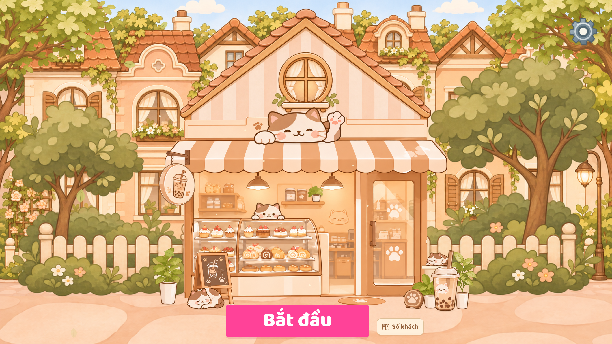

# Animated cat storefront

The title follows the supplied cream/caramel cat-cafe composition. **Bắt đầu** stays at the
bottom centre, **Cài đặt** at the upper right, and **Sổ khách** remains available.
Returning to an unfinished day preserves its cup, customers and clock.

Both orientations now use one complete gabled-cottage design: the same corrected facade, roof,
cat mascot, baker, sleeping cats, plants, cup and easel. The old flat landscape cafe and the later
side-panel composition are no longer rendered. Portrait retains its close framing. Landscape
fits the complete cottage vertically and places compact ground props beside its door, rather than
stranding them at the screen edges. A dedicated wide neighborhood fills the whole background,
with seven houses, balconies, ivy, a bench/rose trellis and a street lamp. The full garden and
swaying corner branches fill the wider margins naturally. Subjects retain their aspect ratios.
Landscape reserves 82 CSS pixels for controls on short phones and 130 on taller screens; the
roof stays at least 24 CSS pixels below the top. Portrait keeps its existing framing and controls.
Settings stays at the safe upper-right corner, start at the bottom centre, and the guest book sits
above start in portrait. GPU and static fallback use the same placement code. Rotation reuses
loaded artwork and the renderer, preserving animation time.

The shared storefront uses its original proportions under **one uniform transform**: facade,
door, shelves, case, wall motif, lamps, roof cat and baker. The striped awning retains its native
size and height, translated 32 native pixels left to center its hem over the facade posts. Its
scalloped alpha edge follows the existing brown outline, with a narrow wall strip restored behind
it so the old awning does not remain visible. The ground line sits 210 CSS
pixels above the bottom in the earlier framing; the closer framing now leaves 180 CSS pixels
on short phones and 200 on taller phones for the controls. The upper
space now shows an opaque painted neighborhood of four tall houses, ivy, balconies and plants,
behind the main terracotta gable. Its full image is uniformly cover-fitted above the doorstep.
The sky/cloud/bird layer remains only a fallback when the neighborhood cannot load, so birds
never fly over house windows. Both roof posts align
with the original cafe posts. Portrait reserves at least 56 CSS pixels above the roof;
short phones uniformly reduce the house and all foreground props to fit their complete silhouettes.
Landscape fits the same cottage and keeps its props together on the doorstep. The cafe is not stretched vertically;
no extra glass panes or shelf gaps are inserted and pastries are not sliced.
The fascia below the roof cat ends exactly at the posts x320/1367. Its original rounded end caps
are moved inward, retaining the central painting and raised cat tab at their original positions.
The upper cornice is likewise fitted to its posts x148/1388, preventing small projecting tabs
behind the fascia. Both changes apply in either orientation and preserve the tall roof.

All garden props sit directly at the
foot of the facade: the pot and floor cat beside the easel, and the native cup/plant/paw-sign
arrangement beside the entrance ledge. Their ground contacts are fixed offsets from the doorstep
in shop coordinates, not fractions of unused courtyard height. Props retain the previous compact
scale while the cafe zooms closer. The right group moves slightly forward only if its straw would
cross the lower door paw motif, keeping ground contacts within a short band at the doorstep.
The right sleeper, ledge and right garden share the original arrangement's transform,
preserving the relationship between the cat, cup straw and ledge. The easel is drawn ahead of
the left foliage so its lettering remains visible. Its baked-in original is removed only inside
the old easel silhouette using the restored cabinet plate.
Soft contact ellipses ground the pots, cup, round sign and ledge on the paving.
[329×738, matching the reported phone size](title-storefront-329.png).
[Foreground close-up](title-portrait-foreground.png).



[Current animation](title-storefront-motion.webm) · [Cat pose close-ups](title-cat-poses.png) ·
[Portrait](title-storefront-390.png) · [Landscape phone](title-storefront-932.png) ·
[Responsive portrait animation with kitten audio](title-storefront-portrait-motion.webm).

[Sleeping cat tail attachment](sleeping-cat-tail.png): the original joined hip/tail artwork is
preserved exactly and remains one connected silhouette through 32 sampled breathing frames.

[Cup and adjacent foliage](title-cup-foliage.png): the exposed leaves remain visible and the
straw stays continuous through the wind cycle.

[Simple wrist wave](title-simple-wave.png): the wrist folds and unfolds once, returning through
the same poses while the curved shoulder stays tucked behind the cat. Raised poses show the pads.

## Composition and motion

- The source backdrop is **one complete, coherent painting**:
  [storefront-base-v3.png](../src/assets/title/storefront-base-v3.png).
  It contains no real cats, foliage, hanging sign or their old shadows. The renderer draws the
  entire image unchanged at the reference aspect ratio. Other viewports extract its architecture
  and props onto one continuous wall/courtyard; no silhouette-shaped environment patches are blended.
  The portrait door's formerly occluded lower corner uses its own symmetric opposite corner;
  the landscape stone ledge extends as plain architecture, without copying baked-in cup/pot pixels.
- [storefront-cats-v3.png](../src/assets/title/storefront-cats-v3.png) supplies all four transparent
  cats. Each has a separate breathing rhythm anchored to its support. The roof and baker cats
  gently sway, the baker blinks, and the right sleeper's tail moves independently. The roof cat and
  its tail remain one intact original sprite: no rectangular tail extraction or cut edge is exposed
  when the paw folds. The left sleeper's
  curled tail and haunch remain one intact sprite and share its breathing, preserving their original join.
  Ears stay attached to the complete head artwork. Contact shadows are soft ellipses, not cutout shadows.
- The first four drawings in [fortune-arm-wrist-v6.png](../src/assets/title/fortune-arm-wrist-v6.png)
  supply a simple raised-palm-to-folded wrist bend with cream/caramel fills and rounded brown outlines.
  Every 1.2 seconds, the wrist bends once and returns through those exact poses in reverse.
  Peach pads are visible when raised and tuck away as the wrist folds. The raised palm is 80 native
  pixels wide, comparable to the resting paw (about 90 px). The curved shoulder extends into the body
  at (905,138) and is drawn behind the cheek, hiding the sprite endpoint.
  Depth order is head/body, waving paw, then the native cheek artwork clipped along its curved
  painted contour. There is no rectangular clipping edge at the wrist. The toe-to-wrist transition
  is rounded in the source atlas too. Never repaint the entire head over the paw: its ear/edge clips the hand.
  There is no whole-arm vertical translation, compression, extra palm turns or greeting shakes.
  Painted interiors are opaque, preserving only the antialiased outer edge.
  Background and idle transforms render at up to 60 fps.
- Clicking either interactive cat plays a short recorded kitten meow through the existing SFX
  volume and mute settings. The cue is warmed before interaction and has a one-second retrigger guard.
  [Recording and CC0 credit](../src/assets/audio/CREDITS.md).
- [foliage-layer.png](../src/assets/title/foliage-layer.png) supplies five rigid foliage groups.
  Each rotates around its branch/stem. Cropped edge greenery extends outside the viewport, so
  wind cannot reveal a straight texture boundary.
- Foreground props now use the **complete transparent painted silhouettes** in
  [storefront-foreground-v3.png](../src/assets/title/storefront-foreground-v3.png), with alpha bounds
  and uniform scaling. The cup/right pot and paw sign/front pot retain their source overlap as
  two connected groups. Full pot mouths cover the leaf roots, and the cup is painted last so a
  neighboring pot cannot erase its outline. The right cluster is inset from the screen edge.
  The top canopy now uses a viewport-aware size and places the trunk's source edge 32 CSS pixels
  outside the viewport, preserving a broad leafy silhouette while it sways.
  The sleeping cat on the floor is drawn in front of the left pot.
- The hanging sign and **three overlapping closed chain links** are one sprite. The chain top
  is the rotation pivot at (166, 212), fixed to the bracket. No thresholded chain fragments.
- The original [cat-storefront.png](../src/assets/title/cat-storefront.png) remains a temporary loading
  image. A Canvas 2D snapshot of the responsive scene handles reduced motion, context loss and
  unavailable WebGL. Ambient CSS adds leaves, dust, sleep letters and light.

## Code

- [Storefront.tsx](../src/ui/Storefront.tsx): loading, pause/visibility/reduced-motion lifecycle,
  context restoration and fallback.
- [storefrontArt.ts](../src/ui/storefrontArt.ts): coherent backdrop, foliage, connected sign,
  foreground silhouettes and contact shadows.
- [storefrontCats.ts](../src/ui/storefrontCats.ts): complete cat bodies, tail parts and blink.
- [fortuneCat.ts](../src/ui/fortuneCat.ts): wrist bend, reversed return and foreleg alignment.
- [titleSprite.ts](../src/ui/titleSprite.ts): alpha cleanup, atlas extraction and edge padding.
- [storefrontMotion.ts](../src/ui/storefrontMotion.ts): cached native art and GPU compositing.
  Raster assets are prepared once per URL set, not repainted each frame.
- [storefrontLayout.ts](../src/ui/storefrontLayout.ts): subject transforms and shared touch positions.
- [storefrontPortrait.ts](../src/ui/storefrontPortrait.ts): native facade/architecture extraction.
- [storefrontScene.ts](../src/ui/storefrontScene.ts): shared GPU and Canvas 2D composition.

## Verification

- Typecheck, production build and the complete regression suite pass.
- At 329×738, 390×844 and 320×568, 58,797 comparisons across pastry rows, original shelf art and
  the door paw decal match the untouched source under the shared transform (no RGB delta above 2).
  This guards against distorting or repainting the cafe while filling the upper screen.
- Responsive browser checks cover 320×568, 390×844, 430×932 and their landscape orientations,
  768×1024, 1024×768, 1672×941 and 2560×1080, including rotation without recreating the renderer,
  notch/home safe-area simulation, cat greetings, settings/book/start, context loss/restoration
  and no-WebGL portrait fallback. No control overlaps or page errors.
- GPU/static frame comparison at 390×844, 932×430 and 1672×941 has mean RGB error below 0.01/255,
  with every pixel opaque and animation present in every composition. The existing 145,871
  upper-paw comparisons still pass with zero covered paw pixels and zero changed cheek-root pixels.
- Regression layout checks keep all four cats, the cup/straw and easel fully inside 12 viewport
  sizes, preserve subject aspect ratios and clear the portrait controls. They also guard the
  shop/foreground spacing, header clearance and visibility of the lower door artwork, so mere
  on-screen bounds cannot accept the earlier disconnected portrait layout.
- Foreground layout guards preserve the original right-cluster arrangement, keep the entrance
  clear, limit prop scale relative to the shop, and hold the sleeping cat to its supporting ledge.
  Every pot, cup, sign, floor cat, easel and ledge contact must remain within 65 native shop pixels
  of the facade's ground line, including across viewport changes. No object positions depend on
  how much courtyard remains below the shop.
- Browser interaction checks at 1672×941, 1284×800, 932×430, 390×844 and 320×568 (DPR 1–3):
  cat greeting, settings/book, start, resume, reachable controls and no screen overflow.
- Native frame comparisons show motion in **all four cats**, sign and foliage, while the awning,
  wall, doorway and pastries stay unchanged.
- Across 16 sampled animation times, **707,904 opaque cup-pixel comparisons** match the backdrop exactly:
  foliage cannot alter the protected cup artwork.
- Across 48 wind frames, **50,928 independent painted-straw pixel comparisons** match the backdrop;
  foreground masks leave the exposed foliage between the paw sign, cup and pot untouched.
- The four wrist poses retain at least 90.8% of the largest pose's painted area. Their curved
  shoulder endpoint is covered by intact cat artwork. Every pose forms one connected silhouette
  with the cat; raised poses show 647 visible pink-pad pixels versus 158 when fully folded.
- Browser clicks verify the actual 880 ms kitten sample plays for both cats, rapid taps do not
  overlap it, SFX mute suppresses it, and the complete original roof-cat RGBA is preserved exactly.
- Across 32 rendered frames, 145,871 opaque upper-paw pixel comparisons match the isolated
  paw artwork, with no head layer covering it; the shoulder still matches the cheek underneath.
- Alpha connectivity checks trace from the bracket anchor through the chain to the sign body.
  Unit checks cover one wrist bend and matching return, fixed support contacts and rigid sign attachment.
- Reduced-motion changes, modal pause, WebGL loss/restoration and no-WebGL fallback work.

## Image provenance and prompts

### Wide neighborhood for the shared landscape cottage (active)

Asset: [storefront-neighborhood-landscape-v1.png](../src/assets/title/storefront-neighborhood-landscape-v1.png).
Mode: built-in imagegen, opaque illustration using the portrait neighborhood and original cafe
as style references. The foreground is the same cottage composition in both orientations; this
plate adds a coherent wide street behind it rather than preserving the old flat landscape menu.
The neighborhood includes seven distinct houses, small balconies/planters, rose trellis, bench,
lamp and leafy greenery. Existing garden and moving branches overlap it at the same ground line.

Exact prompt:

```text
Use case: illustration-story. Asset type: NEW WIDE LANDSCAPE NEIGHBORHOOD BACKGROUND PLATE for the same cat cafe game. Image1 is the existing portrait neighborhood design/style authority; image2 sets the original cafe's warm cream/caramel hand-painted 2D storybook style. Recompose the neighborhood as a wide2048x1024 landscape scene, with SEVEN distinct narrow two-storey neighboring homes along a shared horizontal street baseline near y970. Vary their warm pale peach, ivory and biscuit plaster facades, simple terracotta/caramel gabled and gently curved tiled roofs, small domestic arched and rectangular wooden windows with ivory curtains, restrained shutters, tiny balconies, cream flower boxes and trailing olive ivy. The side regions should be richly but calmly occupied: a short cream fence with peach/ivory flowering shrubs near both edges, a modest wooden garden bench at the far left beside a climbing rose trellis, a slender warm bronze street lamp at the far right near a leafy tree. Add small clusters of olive/sage trees between roofs and along the sides. Keep these details small relative to the buildings and sensible scale. Broad frontal elevation with gentle coherent depth; no forced perspective, no spatial warping. Rooflines begin at y80..220, houses and greenery occupy almost all of the frame, only a thin pale blue/cream sky strip at the top. Small neighboring windows about80..120px wide so their scale stays subordinate to the foreground cafe entry door. CENTER LOWER60% stays visually quiet because a separately rendered foreground gabled cat cafe will overlap it; do not draw that main cafe here. Background buildings should be lighter and slightly muted compared to the cafe, without blur. Ground is just a thin peach stone street strip at the bottom5%, not a large empty courtyard. Same crisp rounded fine brown outlines and simple soft painted color shapes as references. NO foreground cafe or shop awning, no cats, no people, no vehicles, no giant cup, no writing/signage, no UI/buttons, no watermark, no photorealistic 3D. This is a complete seamless opaque landscape painting, not two clipped side panels or repeated copies of one house. Fill every pixel, no transparent background.
```

### Neighborhood behind the closer portrait cafe (active)

Asset: [storefront-neighborhood-v1.png](../src/assets/title/storefront-neighborhood-v1.png), 1024×1536.
Mode: built-in imagegen, opaque illustration. Style references: `cat-storefront.png` and
`storefront-side-garden-v2.png`. The added houses replace the broad blue sky only in portrait.
The existing foreground cafe is composited unchanged over this plate, with its current matching
roof and posts. Upper corner trees grow from 72% to 84% viewport width (capped at480 CSS pixels),
move 12 CSS pixels lower and keep their trunk endings64 CSS pixels beyond each side. Their rigid
sway and the existing cat/sign/plant motion remain active; landscape uses the earlier composition.

Exact prompt:

```text
Use case: illustration-story. Asset type: full-bleed PORTRAIT 1024x1536 NEIGHBORHOOD BACKGROUND behind a separately composited foreground cat cafe game. Reference1 supplies the exact warm cream/caramel hand-painted 2D storybook architectural style; reference2 supplies the rounded olive greenery style. Draw a cozy small residential street with FOUR neighboring tall narrow TWO/THREE-STOREY HOUSES, front-facing with gentle depth, their cream, pale peach and muted warm biscuit facades extending all the way to a shared street baseline near y1480. Their staggered terracotta/caramel tiled rooflines begin high in the canvas, around y100..350. Small domestic wood-framed arched and rectangular windows, ivory curtains, modest flower boxes, restrained wooden shutters, low balconies, decorative plaster cornices, little climbing ivy between houses. Make it read as a continuous inhabited neighborhood, not isolated floating house cutouts or a toy village. Tall houses fill most of the upper and side regions; do NOT leave a large empty sky. Only thin soft warm pale-blue/ivory sky gaps between rooftops in the upper 10 percent. A few rounded olive/sage trees and flowering shrubs stand BETWEEN the neighboring houses, ivy drapes lightly over some roof corners. Keep the central lower two-thirds calm: the separately rendered foreground cafe will cover that area. Houses behind should be softly muted and slightly lighter, preserving crisp simple painted edges, so a closer foreground cafe remains the focus. Ground is only a thin warm peach paving strip in the bottom 5 percent, no big empty courtyard, no horizon split through building walls. Consistent warm afternoon light and coherent scale. Same rounded fine brown linework and soft flat painterly texture as reference, no photorealism, no 3D, no blur, no excessive tiny detail, no spatial warping. No cafe storefront or awning in the foreground, no cats, no people, no cars, no giant cups, no UI, no text/lettering or watermarks. The purpose is to REPLACE the large empty blue sky behind the foreground cafe with more houses and greenery. Opaque image, fill every pixel to every edge.
```

### Cabinet behind the relocated easel (active, portrait only)

Asset: [storefront-easel-clear-v1.png](../src/assets/title/storefront-easel-clear-v1.png).
Mode: built-in imagegen edit of `storefront-base-v3.png`, opaque output. Only the pixels inside
the original easel silhouette are composited into the portrait facade. All other native painted
details and the entire landscape composition remain unchanged. This makes room to enlarge the
cafe and reposition its easel without leaving a second board baked into the background.

Exact prompt:

```text
Use case: precise-object-edit. Edit this exact 1672x941 warm illustrated cafe background. Change ONLY the freestanding wooden easel/chalkboard at lower left, x203..460,y546..870: REMOVE that easel completely and reconstruct the small area of cafe front which it hides. Behind its left side continue the existing peach wall and straight vertical wood corner post around x320..355. Behind its right side continue the left pastry display cabinet: clear glass with a few small matching cakes, thin horizontal shelves, and the cream lower cabinet panel, same exact perspective, geometry, brushwork and light. Continue the paving under its legs naturally. Do not add any replacement object or board. Preserve absolutely EVERYTHING ELSE, all original image dimensions/positions, awning, upper signboard, lamps, shelves, case, cakes elsewhere, front door, pots, cup, colors, detailed outlines and original warm hand-painted style. No new characters, no foliage, no text, no UI. This is a surgical board removal for a sprite-composited game; the rest of the input must stay unchanged, crisp and aligned. Output the full original 1672x941 landscape image.
```

### Complete portrait plant and two corner trees (active)

Assets: [storefront-right-leaves-v1.png](../src/assets/title/storefront-right-leaves-v1.png) and
[storefront-corner-trees-v1.png](../src/assets/title/storefront-corner-trees-v1.png).
Mode: built-in imagegen, transparent output, with `foliage-layer.png` as the style/identity reference.
The right plant has a complete outer leaf contour and a converging stem root anchored inside the
existing pot at native (1630,755). Its original rectangular edge is no longer used in portrait.
The upper trees include both wood and leaves in the same sprite. The two atlas halves rotate
around their outside roots, with 48 CSS pixels of outer-edge padding so the trunk endings stay
offscreen during the sway. These complete silhouettes are shared by both orientations.

Right-plant prompt:

```text
Use case: precise-object-edit. Asset type: ONE isolated transparent foliage sprite for the white plant pot immediately RIGHT of a large bubble tea cup in this existing cafe. Reference 1 contains the exact drawing style and leaf shapes: use ONLY its far-right potted plant as identity/style reference. Reconstruct that small houseplant as a COMPLETE standalone silhouette, repairing the abruptly chopped rightmost leaves. Portrait 768x1024 canvas, centered. A modest upright cluster of broad pointed oval olive and light sage-green leaves on two or three slender green stems, the same simple warm hand-painted cream/caramel 2D storybook style, restrained brown-green outlines and subtle pale leaf veins. Leaf cluster about 500px wide and 760px tall; ALL leaves fully inside canvas with at least 80px transparent margin on every side. At the bottom, all stems converge naturally to one root point centered at x384,y925, ready to tuck into a separately drawn white flowerpot. Full rounded leaf contours all around, no flat vertical edge, no rectangular clipping, no cut-off branches. Keep the leaves simple and match the original plant; not lush realistic glossy leaves, not 3D. Opaque painted leaves and stems with subtle clean antialiasing, ACTUAL alpha zero everywhere outside the silhouette and between branches. No pot, no cup, no other plant, no background, no floor, no sky, no flowers, no shadow or halo, no text.
```

Corner-tree prompt:

```text
Use case: illustration-story. Asset type: two complete upper-corner tree sprites in ONE transparent 1536x768 atlas for framing a cat cafe game sky. Reference is the existing soft warm cream/caramel/olive 2D hand-painted foliage. Draw TWO independent tree corner wings, each in its own 768x768 half of the atlas. LEFT half: an integrated warm brown trunk curves up from the LEFT border around x0,y720 into a broad canopy of olive/lime rounded leaves across x0..650,y0..400. RIGHT half: mirrored integrated trunk enters from the RIGHT border around x1536,y720, canopy spreads across x886..1536,y0..400. Both branch structures must be naturally connected to their leaves with NO pasted seam or mismatched cutout. Trunks continue OUT through the outer left/right canvas borders, NEVER finish in midair. Dense charming leafy crowns with visible small forked branches interwoven, small leaf gaps reveal true transparency. Generous transparent inner sky gap x650..886; the LOWER CENTRAL areas of both halves remain transparent too. Leaves may extend beyond TOP and OUTER SIDE borders where they will be cropped by the actual screen edge, but absolutely no flat clipped edge INSIDE the atlas, especially at center x768. Simple rounded shapes, restrained detail, crisp painterly outlines, original warm illustration palette, no realistic rendered wood/fur, no blurry texture. Actual alpha zero outside trees and between branches. Each half must read as ONE complete connected tree branch and canopy, not separately assembled trunk/leaf layers. No sky, house, ground, pots, cups, cats, text or watermark, no halo.
```

### Side garden behind the cottage (active v2)

Asset: [storefront-side-garden-v2.png](../src/assets/title/storefront-side-garden-v2.png).
Mode: built-in imagegen, transparent output; original clean cafe painting used as style reference.
First pass `storefront-side-garden-v1.png` is retained but unused. The refinement completes the
outer tree and shrub edges so they can sit inside wide layouts without a straight texture cutoff.
Trees, cream fence and flower bushes sit behind the house and in front of the sky. Their lowest
painted alpha is measured once and anchored to the same doorstep ground line, rather than a
fixed assumed image baseline. Portrait reveals the garden at the sides; landscape shows both wings.

Initial prompt:

```text
Use case: illustration-story. Asset type: transparent garden scenery layer BEHIND an existing cat cafe cottage in a 2D game. The reference is the exact cream/caramel warm hand-painted storybook style. Create one wide LANDSCAPE 1536x768 transparent sprite, a quiet cozy neighborhood garden framing a house that will be composited separately in the CENTER. Along the LEFT edge x0..430: a small olive-green leafy ornamental tree with a warm brown slim trunk, rounded leafy canopy near y150..420, low cream picket fence extending from x0 to520 at y520..690, and modest rounded shrubs with a few tiny ivory/peach flowers at their base. Along the RIGHT edge x1130..1536: a slightly taller soft leafy tree with canopy around y80..380, low matching cream picket fence from x1030 to1536 at y520..690, layered olive/sage bushes and a few small warm peach flowers. The entire CENTRAL area x530..1010 must be transparent and empty for the separately composited house. All garden objects share ONE HORIZONTAL GROUND CONTACT BASELINE at y700. No visible soil rectangle or painted ground plane: shrub bases are organic rounded silhouettes tapering naturally to the baseline. The fence can continue behind the empty central area only as transparent gaps, not a solid wall. Frame edges can crop off outermost leaves naturally, keep both trees mostly inside the sprite. Simple rounded outlines, gentle warm afternoon light, cream/peach/olive colors, slightly muted distant foliage so the cafe stays the focus. Use a soft hand-painted 2D illustration matching reference, crisp opaque paint inside shapes, no realistic 3D. ACTUAL alpha zero outside all foliage, tree, fence and flower shapes, especially upper sky and central house region. No sky, NO HOUSE, no buildings, no cats, no people, no cup, no sign, no text, no UI, no halo or surrounding shadow. It will be placed behind the cafe as two side garden wings, not in front of its door.
```

Refinement prompt:

```text
Use case: precise-object-edit. Edit this exact transparent two-wing garden sprite. Preserve both cream picket fences, olive trees, shrubs, peach/ivory flowers, original left/right arrangement, central transparent gap, warm flat hand-painted style and shared ground baseline. Fix ONLY the silhouettes at the canvas borders: BOTH trees and all bushes must be FULLY COMPLETE rounded natural silhouettes inside the canvas, with at least 40 transparent pixels of margin on every outer side. The RIGHT tree canopy currently ends in a hard straight vertical cut at the right image boundary: restore its complete leafy rounded right side. The LEFT shrubs have a hard vertical boundary too: round off their full outside leaf clusters. Replace the long ruler-straight horizontal shrub bottom edges with gentle irregular rounded leaf lobes and small organic ground contacts, no rectangular flat shelf of green paint. If necessary uniformly shrink both side garden wings by about 10 percent around their inner centers so their complete contours fit. Keep a wide transparent empty center for the separately rendered house. NO cut or truncated leaves at any border, NO plants touching the canvas edges, NO ground rectangle, NO sky, NO house, no people/cats, no lettering. Actual alpha zero outside all garden shapes and in center. Keep all painted interiors opaque, crisp edges with subtle antialiasing only; no exterior red/yellow fringe, no glow or smoky halo.
```

### Tall cottage roof with balanced eaves (active v3)

Asset: [storefront-house-roof-v3.png](../src/assets/title/storefront-house-roof-v3.png), 1536×1024.
Mode: built-in imagegen edit of the original high v1 roof, transparent output. The preferred high
apex y230 and existing cafe zoom are restored. Only the overhanging tile ends are shortened:
left tip x126 and right tip x1408, about 22/20 native pixels beyond the posts at148/1388,
instead of the earlier 68-pixel extensions. Both sides remain aligned with the lower posts.
The portrait left post now uses one continuous painted strip from `storefront-easel-clear-v1.png`
at native x320..355,y294..827, avoiding the horizontal wood-color seam at the old board patch.
The same corrected roof and fascia are shared by both orientations.

Exact prompt:

```text
Use case: precise-object-edit. Edit THIS EXACT HIGH, STEEP gabled attic sprite. Preserve its original high apex at x768,y230, circular window and sill positions, tall triangular silhouette, terracotta/caramel style, straight wall posts at x148 and1388, and base cornice y840..900. DO NOT lower the roof or shorten its height. Change ONLY the TWO EAVE TIPS: the roof currently extends too far sideways past its wall posts, to x80 on left and1456 on right. Shorten BOTH overhanging tips so the complete leftmost roof edge ends at approximately x130 and the rightmost roof edge at x1406 (equal18px overhang relative to wall posts148 and1388). Redraw the ends of the terracotta tiles and timber trim neatly to follow that narrower roof slope from the SAME high central apex. Keep both sides exactly symmetric and tidy, with rounded natural tile tips; do not crop off the tips with a straight mask. Keep the wall itself, window, small leaves and lower cornice unchanged in width, location and height. No roof edge may extend beyond x130..1406 except a 1px antialias edge. Keep the existing original warm cream/peach striped wall and rounded simple brown contours, no blur, no new objects. Actual alpha ZERO outside the building silhouette, no surrounding halo/glow or smoky shadow, opaque paint inside. Preserve1536x1024 canvas alignment. No sky, cafe ground floor, awning, cats, text or watermark. Restore the preferred high roof, simply shorten the excessive overhang on BOTH left AND right.
```

### Compact cottage roof (superseded v2)

Asset: [storefront-house-roof-v2.png](../src/assets/title/storefront-house-roof-v2.png), 1536×1024.
Mode: built-in imagegen edit of v1, transparent output. The roof peak moves from native y230
to y414 while the posts x148/1388 and base y900 remain fixed. The gable is about 27% shorter,
with freshly painted shallower tile slopes and a smaller circular window. Its height is now
about 61% of the lower facade frame. `fitPeakY` retains the earlier camera fit, so this roof
change does not zoom the cafe out or alter ground props. Applied only to portrait.

Exact prompt:

```text
Use case: precise-object-edit. Edit this EXACT transparent roof/attic sprite, keeping canvas1536x1024 and the building wall side positions x148 and x1388, bottom cornice y840..900, its flat horizontal base y900, centered alignment, cream/peach vertical plaster stripes, same warm terracotta tiles and simple hand-painted cream/caramel storybook style. The current gabled roof is much too tall and steep compared with the cafe beneath it. Change the ROOF PITCH and ATTIC HEIGHT: LOWER the apex from y230 to approximately y430 while keeping both eaves near x80,y790 and x1456,y790 and retaining the same straight wall posts at x148/1388 and same bottom y900. Thus make a broad LOW-PITCH compact cottage gable, about30 percent shorter, rather than a huge towering triangle. Repaint coherent natural terracotta tiles and caramel timber bargeboards along the shallower slopes; do NOT squash/stretch the existing tiles or wood texture. Shrink the circular attic window from its current oversized diameter to about180px, center it at x768,y710, keep small ivory curtains and a modest cream sill with two tiny olive-green leaf accents. The complete small round window and sill must fit within the lower gable, not touch either roof slope. The lower cornice and wall posts MUST stay exactly aligned to the original positions, so this sprite joins the same cafe width unchanged. Preserve crisp rounded brown outlines and original flat gentle paint, no blur, no photorealism or extra detail. All building paint opaque; actual alpha ZERO outside the new shorter silhouette, especially above the lower roof apex and beside the eaves. NO colored halo, shadow/glow around silhouette, backdrop or sky. No new objects, no cats, no ground floor or awning, no people, no text. This edit reduces just the roof's visual mass without changing the scale of the cafe under it.
```

### Cottage roof and animated sky (superseded v1 roof)

Asset: [storefront-house-roof-v1.png](../src/assets/title/storefront-house-roof-v1.png), 1536×1024.
Mode: built-in imagegen, transparent output. References: original `cat-storefront.png` and the
previous `storefront-upper-storey-v2.png`. Only the attic/roof is generated, while the original
ground-floor cafe, cats and props retain their painting. The source wall edges x148/1388 and
base y900 join the lower posts x320/1367 at y148. The circular attic window sits within one
triangular gable, rather than a separately framed upper storey.

`storefrontSky.ts` builds reusable canvas sprites for the gradient sky, three small cream clouds
and eight distant bird-wing poses. Clouds translate without deformation, birds follow separate
horizontal routes with a small vertical arc, and wings flap at 1.8 cycles/second. Everything
uses the existing elapsed scene clock, so pause, reduced motion, rotation and context restoration
work for the sky as well as the cats. The sky is painted before the complete building silhouette.
Full prompt:

```text
Use case: compositing. Asset type: transparent roof and attic extension sprite for the existing cat cafe in reference image 1. Reference image 1 sets the exact warm cream/caramel simple hand-painted 2D storybook style. Reference image 2 is a previous upper-floor sprite; replace that design with ONE coherent triangular-gabled house roof and a SHORT attic, not a second full storey with large windows. Output a LANDSCAPE 1536x1024 transparent sprite. Deliberate straight-on elevation: the cream-and-peach plaster facade wall has straight vertical side edges at approximately x148 and x1388, a flat horizontal bottom at y900. The roof is a wide triangular FRONT GABLE with its peak near x768,y150, and low eaves near x90,y600 and x1446,y600. Caramel timber bargeboards with modest warm terracotta tiles along both slopes; restrained tiled shading, same fine rounded brown outlines as the cafe. Beneath the two sloping roof edges the triangular attic wall continues seamlessly into a shallow rectangular plaster wall ending at y900. A SINGLE small round honey-wood attic window, about180 pixels across, centered near x768,y580, softly glowing ivory curtains, small unobtrusive cream sill and two very small olive foliage accents. Warm pale cream and peach plaster, subtle wood corner trim, a fine continuous horizontal cornice at y860..900 ready to tuck BEHIND the cafe's existing cat sign and striped awning. This sprite should make the original ground-floor cafe read as ONE freestanding cozy cottage. The native cafe door/window details will remain unchanged and separately composited under this roof. Keep the exact entire silhouette visible, generous transparent margins. OPAQUE paint inside the roof/wall/window; ACTUAL ALPHA ZERO everywhere outside the building silhouette, above the slopes and beside the walls. NO surrounding smoky glow, no halo, no exterior shadow. No sky, no background wall, no ground-floor cafe, no awning, no cats, no text, no lettering, no chimney, no buttons, no humans. No photorealism, no 3D, no excessive detail, no blur. Keep the warm charming original illustration language.
```

### Full-bleed decorated upper wall (superseded v4)

Asset: [storefront-upper-wall-v4.png](../src/assets/title/storefront-upper-wall-v4.png), 1024×1536.
Mode: built-in imagegen edit, opaque output. Inputs: the previous v1 wall (edit target) and
the original cafe (style and scale reference). First pass saved as `storefront-upper-wall-v3.png`;
the final pass makes the windows and shelf smaller. The standalone roof/sky v2 experiment is unused.
The wall fills the screen width, with native y1450 aligned behind the original awning. It is
clipped to the upper region. Shorter screens reveal the lower windows, lamp and paw panel;
taller screens also reveal the round window and herb shelf. There is no separate roof or sky gap.
The two arched windows are about 140 native pixels wide, narrower than the original entry door
at the displayed scale. Original ground-floor art and animation are unchanged.

Initial wall prompt:

```text
Use case: precise-object-edit. Asset type: opaque architectural wall background plate for the portrait menu of an animated cat cafe game. Image 1 is the EDIT TARGET: keep its full-bleed warm peach-and-ivory striped plaster wall, gentle afternoon light and soft caramel hand-painted 2D storybook style. Image 2 is the original ground-floor cafe STYLE AND PHYSICAL SCALE reference; it will be composited separately unchanged. Main change: REPLACE the two enormous windows in image 1 with a tasteful collection of SMALL architectural details at the scale of the cafe's entry door. Create a PORTRAIT 1024x1536 full-bleed flat frontal wall illustration. No roof, no silhouette of a standalone building, no sky, no visible outer building edges, no horizon. The wall must fill every pixel to all four canvas edges so it joins the original facade continuously. Cream and pale peach vertical plaster stripes throughout. Composition measured on this 1024x1536 canvas: in the lower half, two modest arched honey-wood windows with tied ivory curtains and small cream flower boxes, one around x235 and one around x770, each about 140 pixels wide and 230 pixels high, tops near y1000, bottoms near y1230. These domestic windows must be SMALL, each less than one sixth the wall width. Between the two windows, a narrow little decorative cream-and-caramel inset plaster panel with a tiny paw relief around x510,y1080, not text. Above them, around y600..850, a small round attic window about 130 pixels across at x620, and a short wall-mounted wooden shelf with three tiny terracotta herb pots around x310,y800. A few subtle horizontal plaster moldings and slender wood trim tie these small features together, without dividing the wall into dramatic tiers. Small warm bronze wall lamp near x520,y1330 and short trailing olive ivy down the far side edges. Keep the lowest 120 pixels mostly clean striped wall so the existing cat and cafe awning can overlap it naturally. Add small leaf shadows and restrained fine plaster texture, calm coherent spacing, no clutter. Keep room at upper right for an existing settings button; do not paint a button. Small details spread through the wall, no giant focal window, no giant empty sky. Match image 2's simple rounded brown outlines, cream/caramel paint and crisp warm illustration. No photorealism, no 3D render, no blur. Do NOT include ground-floor cafe, cafe awning, signboard, cats, characters, bubble tea cups, ground, patio, UI, lettering or watermark. Output this wall plate only; the original lower cafe and all animations remain separate and unchanged.
```

Final refinement prompt:

```text
Use case: precise-object-edit. Edit this exact full-bleed 1024x1536 illustrated striped-wall plate. Keep the entire wall, pale peach/ivory palette, all stripes, ivy, molding positions, small center paw plaque, bronze lamp, texture and composition unchanged. Change ONLY the three windows: shrink BOTH lower arched windows, including their wood frames, curtains and attached flower boxes, to 65 percent of their current width AND height, about 140px wide x180px high for each window itself. Keep the centers of their window frames in the same locations, fill exposed areas with seamless matching striped plaster wall. Shrink the upper round window to 60 percent of its current diameter, about130px diameter, keep its center fixed and preserve the horizontal molding behind it continuously. Reduce the three-pots wall shelf and its pots to80 percent of their current size, fixed center. These small details must be domestic scale, much smaller than the cafe doorway they will sit above. Do not enlarge or move other items, do not remove the flower boxes or curtains, do not introduce a roof, sky, ground floor or text. Keep wall completely opaque and filling every pixel edge to edge. Crisp same soft caramel 2D painted style, no blur.
```

### Upper storey above the original cafe (superseded v1)

Asset: [storefront-upper-storey-v1.png](../src/assets/title/storefront-upper-storey-v1.png), 1254×1254.
Mode: built-in imagegen, new illustration using the existing facade and courtyard as style references;
opaque output. It supplies only the upper windows, curtains, planters, ivy and plaster.
The original ground-floor cafe remains a separate native painting. Full prompt:

```text
Use case: illustration-story. Asset type: upper-storey background extension for the portrait menu of an existing animated cat milk-tea shop game. Reference image 1 is the existing storefront and MUST be matched in soft hand-painted cream/caramel 2D storybook style, warm afternoon light, fine rounded brown linework and gentle painterly texture. Reference image 2 supplies the exact peach-and-cream striped plaster wall palette. Create a NEW SQUARE 1024x1024 illustration showing ONLY the upper storey directly ABOVE this cafe, straight-on frontal elevation, no perspective skew. A charming warm cream building wall with two softly arched honey-wood windows in the middle 60 percent of the canvas width. Place the complete window pair in the upper half: tops around 12 percent, bottoms around 48 percent of canvas height. Thin wooden crossbars, softly glowing glass, simple tied-back ivory curtains visible behind glass. Two modest cream window boxes with olive-green leaves, small trailing ivy tendrils hanging down to about 65 percent height. A restrained horizontal caramel cornice around 58 percent height ties the facade together. Subtle vertical cream/peach wall stripes and a little climbing greenery at the far side edges. Keep the bottom 25 percent as clean matching plaster, ready to be occluded by the game's separately rendered original cafe roof. All windows and their main frames must be entirely inside the central 60 percent width, not cut off by edges. This is an architectural BACKGROUND PLATE, not a complete menu: NO ground-floor shop, NO cafe awning, NO shop sign, NO cats, NO characters, NO giant bubble-tea cup, NO floor, NO courtyard, NO buttons, NO settings gear, NO text or watermark. Do not redesign or redraw the original ground-floor artwork; that is composited separately. The new upper storey should look painted by exactly the same artist as the reference, crisp and warm, not realistic 3D, not blurry, not photorealistic, not overly detailed or cluttered. Fill the entire square with the facade.
```

### Responsive wall and courtyard extension (active)

Asset: [storefront-courtyard-v1.png](../src/assets/title/storefront-courtyard-v1.png), 1024×1536.
Mode: built-in imagegen edit, opaque output. Input style reference: `storefront-base-v3.png`.
Only the empty environment is generated; the facade, pastries, cats, sign, plants and cup retain
their existing artwork. Wall and paving are cropped into separate cover regions for each viewport.
Full generation prompt:

```text
Use case: precise-object-edit. Asset type: seamless environmental extension plate for a responsive cat milk-tea game menu. Input image is the existing clean painted storefront, used ONLY as palette, brushwork, lighting and material reference. Generate a PORTRAIT 1024x1536 environmental background, front view, same warm cream and caramel hand-painted flat 2D storybook illustration, crisp fine brown linework and soft original watercolor texture. The UPPER 48 percent is a quiet peach cream exterior plaster wall with the reference's wide alternating vertical cream and pale-peach stripes, subtle warm afternoon light, understated vertical architectural trim only near outer edges. The LOWER 52 percent is a continuous spacious terracotta/peach cobblestone courtyard receding toward the wall, with the same soft irregular cream stone shapes as the supplied image, small stones near the wall and larger stones near the bottom. The wall meets the courtyard along one straight horizontal baseboard at 48% of image height. This is a clean empty environmental plate: NO shop, NO building facade, NO windows, NO awning, NO door, NO sign, NO tree, NO leaves, NO potted plants, NO animals, NO cups, NO pastry case, NO furniture, NO lettering, NO icons, NO user interface. The original storefront and all animated subjects will be composited in code, so this entire wall and courtyard must remain unoccupied. Keep the original warm soft palette and unobtrusive painted texture, no photorealism, no 3D, no heavy outlines on stones, no blur, no dark shadows, no new decorative subjects. The central wall should be clean for placing a separate facade. Fill the whole canvas edge to edge.
```

All active generated assets use the built-in **imagegen** tool, with the original storefront
painting as the reference. They are saved in the project; Codex's generated originals are retained.
The unused earlier experiments are not imported by the game.

### Original reference-matched painting

Saved as `src/assets/title/cat-storefront.png`.

```text
Use case: precise-object-edit. Asset type: base scenery for animated game title. The attached image is the EXACT visual target, not a loose inspiration. Reproduce it almost identically: same flat soft hand-painted 2D kawaii illustration, same simple rounded brown outlines, same muted pale peach cream caramel palette, same camera and every object's position and scale. NO photorealism, NO realistic textures, NO extra contrast, NO elaborate architectural changes. Landscape 1672x941 composition. Keep striped cream/caramel scalloped awning x16%-89% y16%-31%, peach facade, shop window with glass cupcake/roll cabinet x21%-55% y51%-88%, door x65%-81% y31%-88% with paw decals, shelves and lamps, chalkboard lower left, giant illustrated cat-logo bubble tea cup at lower right, pots and green leaves, upper left leafy tree and hanging oval boba sign. Keep all original cats including giant smiling white-and-caramel cat peeking over awning at top center, small cat behind cake counter, sleeping cat lower left and sleeping cat right ledge. Keep the gentle diffuse warm illumination and soft almost pastel colors of the reference. Change ONLY: remove the pink 'phần bắt đầu' rectangle and its text, reconstruct original pavement beneath it; remove top-right white gear button, reconstruct the peach wall there. No lettering, no UI, no watermarks. This should look like the SAME reference artwork with those two interface overlays removed, not a redesigned or reinterpreted shop.
```

### Transparent foliage (reused)

Saved as `src/assets/title/foliage-layer.png`.

```text
Use case: background-extraction. Asset type: full-frame TRANSPARENT FOLIAGE LAYER for compositing back onto this exact reference painting. Keep the EXACT 1672x941 landscape canvas and EXACT positions, sizes, colours and shapes of every plant. Extract ONLY: upper-left green tree canopy (x0..485 y0..269), leaves and slender stems of left potted plant (x0..224 y446..713), shelf plant foliage (x849..928 y340..406), foreground leaves left of large boba cup (x1300..1456 y628..795), and far-right potted plant leaves and stems (x1525..1672 y476..763). Keep complete leaf contours and thin connecting stems, with clean natural antialiased edges. Remove ALL other pixels to true transparency: all walls, architecture, awning, cats, boba cup, sign, white pots, shelf, pastry cabinet and floor. Do NOT include the large brown tree trunk; keep only the leafy canopy and its tiny leaf stalks. Do NOT move plants to the centre or rearrange them, do NOT pack sprites, do NOT scale them up, keep the same original composition as an overlay. Match the original soft cream-and-olive storybook artwork exactly, no new leaves, no new branches, no added shadows or outlines, no halos or patches of background between stems. Transparent background with actual alpha, not a checkerboard. The resulting image must align with the input picture when placed at x0,y0.
```

### Seamless backdrop

Saved as `src/assets/title/storefront-base-v3.png`.

```text
Use case: precise-object-edit. Produce one COMPLETE seamless animation background plate from the provided 1672x941 cafe painting. Preserve the exact soft flat hand-painted cream/caramel style, original composition, perspective, architecture, striped awning, pastry cabinet and cakes, entrance, white pots, giant bubble tea cup with its printed cat logo, chalkboard and wooden hanging-sign bracket. REMOVE ALL FOUR REAL CAT CHARACTERS: the large roof mascot, small baker cat behind the display, sleeping cat lower left, and sleeping cat right ledge. There must be ZERO real cats in this background. Keep only printed cat/paw decorations on objects. REMOVE all green foliage from tree and potted plants, leaving the brown tree trunk, branches and empty pots. REMOVE the oval hanging boba sign and all its hanging chains, leaving its wall bracket. Fully reconstruct the clean wall, floor, pot, fascia, shelf and pastry glass behind those subjects. Remove ALL cast shadows of those removed subjects too: no cat-shaped dark patches, no leaf-shaped cutout shadows, no halo-shaped wall patches, no residual chain fragments. Keep coherent soft afternoon illumination and straight continuous architectural edges. This is one seamless complete image, not a collage of locally patched regions. Do not change the layout, do not repaint in a realistic style, do not add words or UI. Output 1672x941 landscape, sharp original illustration quality.
```

### Four transparent cats

Saved as `src/assets/title/storefront-cats-v3.png`.

```text
Use case: background-extraction. Extract the FOUR CAT CHARACTERS from the provided cafe painting as ONE full-frame transparent layer, exactly 1672x941, all cats at their ORIGINAL pixel positions and original sizes. Preserve their soft cream and caramel paint, brown contours, faces and fur markings exactly. Include large smiling roof cat at x620..995 y10..166, the tiny baker at x610..755 y418..491, sleeping cat lower left x72..325 y751..887, and sleeping cat on right ledge x1390..1543 y492..579. IMPORTANT: omit only the roof cat's foreground RIGHT front paw at x909..1005 y88..168 because its new animated arm is a separate sprite; keep the roof cat's head, left resting paw and curled brown tail. Remove everything else to true transparency: walls, awning, cabinet, plants, pots, sign, floor, ledge, cup and all cast shadows on the scene. Each cat must have a clean complete natural silhouette, no bits of background, no pale outline halos. Do not rearrange cats or centre them, keep the same original 1672x941 composition for direct overlay. Actual transparent alpha, no checkerboard or backdrop.
```

### Foreground silhouettes

Saved as `src/assets/title/storefront-foreground-v3.png`.

```text
Use case: background-extraction. One TRANSPARENT FOREGROUND LAYER, 1672x941 landscape canvas aligned exactly with the provided cafe painting. Extract ONLY these stationary props at their exact original positions and sizes: the complete large cat-logo bubble tea cup at right x1425..1623 y477..878 INCLUDING its entire long straw, lid, cream milk, pearls and full unbroken outer brown outline; the large white plant pot at left x43..175 y701..863; small white pot on wall shelf x866..908 y385..415; white pot beside cup x1375..1450 y779..864; far-right white pot x1594..1672 y749..864; the round brown paw-print sign/stand x1255..1390 y740..862. Reconstruct any tiny prop area hidden by a cat or plant so each object is complete. NO green leaves or stems, NO cats, NO walls, floor, architecture, shelves, scene shadows or other objects. Preserve the original soft cream/caramel illustration, exact artwork and contours. Do not crop any of the cup's sides or straw and do not make a leaf-shaped notch in it. True transparent alpha everywhere else. Do not centre, pack, resize or rearrange the props: preserve the original full-frame composition.
```

### Sixteen simple cartoon foreleg poses (superseded)

Saved as `src/assets/title/fortune-arm-poses-simple-v4.png`, created with built-in **imagegen**.
The original storefront sets the style; the previous pose sheet supplies only the movement sequence.

```text
Use case: style-transfer / precise-object-edit. Asset type: replacement 16-frame cat foreleg animation sprite sheet. Image 1 (the cafe painting) is the STRICT STYLE AUTHORITY: copy the roof cat's simple flat cream and caramel colour blocks, smooth rounded medium-brown outline, two tiny toe crease lines, and minimal pale-peach pad marks. Image 2 (the 4x4 foreleg animation sheet) is the EDIT TARGET and MOTION REFERENCE. Repaint all sixteen poses from image 2 into the exact simple cartoon style of the roof cat in image 1. Keep the same regular 4 columns x 4 rows, same frame ordering, foreleg proportions, shoulder position and wrist-gesture progression. Keep three rounded cat toes, never human fingers. IMPORTANT: remove ALL realistic fur strands, fuzzy edges, hatching, grain, detailed knuckle creases, rendered skin, realistic lighting and sculpted gradients. Use a single flat warm cream fill (#FCEBD6), one simple flat caramel patch (#BF875F) on the lower foreleg, brown outlines (#87512F) matching the cat's resting paw, and at most ONE small flat peach shadow shape to suggest a curled paw. Curved overlapping contour lines alone should show the toes curling; no 3D-rendered shading. When pads face us, use three tiny simple peach marks, not a detailed giant paw-print emblem. Uniform rounded outlines with the same proportional thickness as the existing resting paw in image 1. This must look drawn by the SAME illustrator as the cat, not like a realistic furry arm pasted on a cartoon. Preserve every pose's full shoulder and paw without cropping, fixed shoulder anchor near 50% across and 88% down in every cell, and leave transparent gutters. Output a clean regular square 4x4 sheet, true transparent alpha background, NO red/yellow transparency artefacts, no frame borders, no labels or words. Change the drawing style only; preserve the continuous beckoning animation.
```

### Curved shoulder and visible pads (v5, superseded)

Saved as [fortune-arm-wrist-v5.png](../src/assets/title/fortune-arm-wrist-v5.png), created and
refined with built-in **imagegen**, transparent background enabled. The previous simple paw sheet
and original transparent cat layer supplied the style reference. The 3-by-2 atlas contains six
poses; the renderer uses its first four and reverses that bend.

Initial prompt:

```text
Use case: precise-object-edit. Asset type: transparent 2D sprite atlas for the raised right forepaw of the roof cat in reference 2. Reference 1 is the exact drawing style and paw identity; reference 2 shows the cat it must join. Create a NEW 3 columns x 2 rows atlas of SIX consistent poses, isolated on truly transparent background. Same paw size, foreleg silhouette, shoulder anchor, caramel patch, outline thickness, and position in every equally sized cell, generous transparent margins. Flat simple cream and caramel fills, warm rounded brown outlines, tiny peach pink paw pads, matching the simple hand drawn cat; NO fur texture, no photorealism, no knuckles, no finger details. The upper paw is on the RIGHT of the lower shoulder root. IMPORTANT anatomy: the foreleg bottom bends gently LEFT into a short curved shoulder continuation, like a rounded L or hooked elbow. The LEFT end of that shoulder continuation can tuck behind the cat's cheek. DO NOT draw an isolated standing straight arm with a flat horizontal closed bottom edge! There must be no straight flat cap at the bottom of the foreleg. The underside is one smooth rounded curve curving left into the shoulder. Paw visible above-right, curved elbow below-left. The shoulder joint remains at exactly the same position in every cell. Only the wrist bends, do not move the whole foreleg. Pose order row-major: 1 fully raised wrist, palm facing viewer with three small peach toe pads and one larger central pad clearly visible; 2 slight wrist bend forward with pads still visible; 3 moderate bend forward with partially hidden pads; 4 folded wrist with knuckles forward and pads mostly hidden; 5 same as pose 3; 6 same as pose 2. This is exactly ONE small beckoning bend and return, no wrist twisting, no sideways waving, no fingers opening and closing. Keep toe count consistent. No cat face, no text, no labels, no grid lines, no scenery, no shadow, no colored fringe/debris. Preserve transparency.
```

Refinement prompt, with the generated atlas as its edit target:

```text
Use case: background-extraction. Edit this exact 3x2 sprite atlas. Preserve all six paw drawings, their exact positions, sizes, poses, shapes, colors, curved leftward elbows, and outlines. Change ONLY: REMOVE ALL brown smoky glow, bloom, halos, shadows, gradients, and all background pixels outside the illustrated paw silhouettes, making the exterior completely transparent with alpha zero. Hard clean cartoon cutout edges with only a 1-pixel antialias edge. No glow or shadow anywhere. Also keep interior colors flat opaque cream/caramel/pink exactly as drawn. Six isolated simple cartoon paw sprites on genuinely transparent background. Do not add a background color or checkerboard.
```

### Rounded toe-to-wrist transition (active v6)

Saved as [fortune-arm-wrist-v6.png](../src/assets/title/fortune-arm-wrist-v6.png). Edited from v5
with built-in **imagegen**, with transparent background enabled. The raised pads, palette, simple
style and single bend remain; the curled poses have a rounded outside wrist rather than an inset step.

Exact prompt:

```text
Use case: precise-object-edit. Edit this exact transparent 3 columns x 2 rows cartoon cat paw sprite atlas. Preserve its six tile positions and pose order, exact cream/caramel/peach palette, simple rounded brown outlines, paw size, raised pink pads, lower caramel patch, curved leftward shoulder, transparent gutters, and the single wrist bend animation. Change ONLY the transition immediately UNDER THE LEFTMOST TOE into the LEFT SIDE OF THE WRIST in the curled/bent poses: it currently has a sharp inset step / vertical slice, making the wrist look cut off beneath the thumb. Widen and round just that small outside wrist transition so there is ONE SMOOTH CONTINUOUS CURVED OUTER SILHOUETTE from the leftmost toe down into the foreleg. No right-angle notch, no clipped corner, no straight vertical slice, no broken outline, no thin torn-looking strip, no cutoff ledge beneath the toes. The left toe and wrist must be anatomically joined as one soft plump cat paw, not a fist pasted on a separate narrow tube. Keep the inner toe crease lines short and rounded. The hand still folds forward naturally and pads gradually hide. Keep the same flat simple kawaii illustration, NOT realistic, no fur, no more detail, no new shading. Do not move or resize the root/elbow or change the face of the pads. Fully remove the exterior smoky brown halo/glow; absolutely all exterior pixels should be true alpha zero. Opaque flat paint inside the paw with a clean antialias border only. No background, no text, no grid, no shadows.
```
