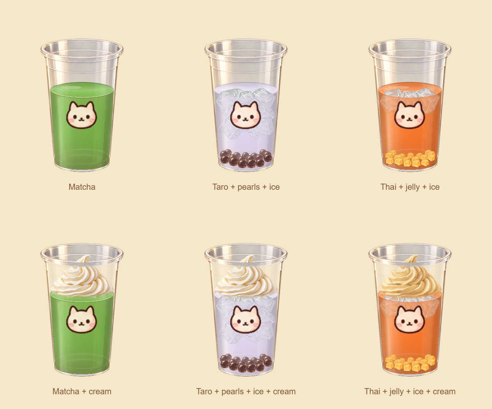

# Refined frontal cup

The playable cup and all contents return to the original frontal viewpoint: tall tapered glass,
shallow elliptical opening, a curved floor, and a clearly visible drink body. S/M/L retain their
relative widths, rack pickup, customer size requirements, and one shared preparation mat.
The kitchen background and station layout are unchanged.

## Artwork and material

- `src/assets/kitchen/cup-glass-natural-front.png` (987 x 1593): new clear PET artwork with a
  layered rolled lip, molded rings, subtle neutral body tint, warm window reflections, and small
  condensation beads. Original transparent alpha is preserved.
- `src/assets/kitchen/cup-cream-natural-front.png` (1402 x 1122): new airy, moist whipped cream,
  finer natural grooves, softly shaded folds, and a curled peak. Brulee keeps its golden custard
  recolor, caramel patches, and toasted flecks.
- `src/assets/kitchen/ice-natural-front.png` (1254 x 1254): the original high-resolution clear-ice
  painting from `tools/sheets/ice-cube-clear.png`, preserved byte for byte. The previous blue face
  shader is replaced by neutral translucent refraction, fine highlights, and a soft thin edge.

The glass and cream were edited with the built-in image generation tool using the imagegen
skill. The final assets are saved in the project; original sources remain unchanged. No CLI/API
fallback or room-image regeneration was used.

`src/art/frontalCupArt.ts` registers the new glass into the original 113 x 174 cup box at six
pixels per logical unit. The lip uses one measured source band; the entire wall and rounded
bottom use a second continuous band, preserving the complete base curve. Cropping and
registration happen once in Canvas; the original PNG stays untouched. A smooth silhouette mask
removes the noisy outer fringe, lightly reduces contrast along the narrow contour, and feathers
only that boundary. Interior glass pixels stay unchanged. High-quality downsampling keeps fine
reflections from becoming jagged on small cups.

The shared outer base ellipse is centered at (56.5, 157.5), with radii 35 x 12.5. The inner
liquid floor is centered at y157.5 and has a front edge at y167, three art units inside
the cup's outer edge at y170. Liquid, toppings, and ice use that same rounded inner floor.
The first trace of tea starts on it, leaving a small clear plastic band underneath. The old independently
compressed foot and bottom fade are removed. The cup stands at the center of its base
footprint, y157.5. A soft contact shadow grounds it on the mat or a dispenser shelf and
disappears while it is lifted. The bottom highlight remains restrained.

`cupPainter.ts` paints live liquid, stable ice placements, and topping portions behind the glass.
Milk uses the tea's actual milky palette; painted surface/body detail is restrained so low-resolution
legacy crops do not dominate the new material. Toppings use the original high-resolution painted
piece atlas with less regular spacing. New portions retain the previous portion's positions.

A light 18% glass reflection crosses filled regions. Foam also uses this continuous clear-glass
reflection to avoid a horizontal seam at the floor. Only the actual near-lip band crosses the
cream at full opacity. The cat print is smaller, leaving more ingredients visible. The finished
cup uses a thin reflective clear dome, molded rim, and a shaded straw whose submerged section
is faint behind the clear plastic.

Cream draws only its painted swirl and a softly blended contact edge. The additional opaque
cap and mixing-plume overlay have been removed so they cannot cover the drink body, ice,
or toppings. Browser pixel comparisons cover cheese and brulee on matcha and taro at shallow,
partial, and full fills; the contents below the contact edge remain unchanged.

## Verification

Run `npm run build` and `npm test`. Geometry checks cover 11,520 complete ice outlines across
seeds, fill levels, and topping layers, continuous floating motion, topping floor clearance, and
cream contact/headroom. Browser checks cover S/M/L rack dragging, live pours and endpoints,
two ice scoops, cup dragging, milk/foam, lidding, straws, and relayout on desktop and phone.
Raster checks at 1%, 18%, 75%, and full fill verify that the actual liquid shape reaches
the rounded floor across its width, including the first small pour.

Previews: [desktop](cup-frontal-desktop.png), [phone](cup-frontal-phone.png).
The [empty-cup edge preview](cup-soft-edge.png) shows the refined contour at phone density.
The [shallow-tea base preview](cup-natural-base.png) shows the aligned liquid floor and contact shadow.

## Generation prompts

Glass input 1: `src/assets/kitchen/cup.png` (old silhouette/perspective reference).
Glass input 2: `src/assets/kitchen/kitchen-room-counter-cups.png` (style and lighting reference).
Built-in output: `exec-5ad4d15d-4feb-4a5e-ae00-b43ab74faf3b.png`.

> Use case: precise-object-edit. Asset type: high-resolution transparent PNG sprite for an animated bubble-tea game. Input image 1 is the old cup silhouette/perspective reference ONLY. Input image 2 is supporting kitchen style/lighting reference ONLY; do not redraw the room. Create ONE beautifully refined EMPTY clear PET boba cup in a frontal view, centered alone on transparent background. Match image 1's tall tapered silhouette and shallow elliptical opening exactly: outer mouth width 104 units, overall cup height 165 units, base width 72 units; mouth ellipse height about 24 units. Camera near eye level looking down about 12 degrees, not overhead. Upgrade the material dramatically: natural crystal-clear thin PET plastic, beautifully resolved rolled lip with layered refraction, delicate molded rings, subtle soft warm-grey contours, asymmetric warm window highlights from upper left, soft amber/taupe edge reflections, fine believable surface irregularities, a few tiny condensation beads on the lower outer wall, no exaggerated blue glow. Polished painterly semi-realistic game illustration matching the kitchen, natural material rendering, not flat vector, not black outlines, not a photograph pasted into the scene. Absolutely EMPTY: no liquid, no cream, no ice, no lid, no straw, no cat print or logo. Crucial: actual alpha transparency outside AND through the clear wall and hollow interior; central body must be nearly transparent so runtime colored liquid behind it shows through; keep only subtle low-opacity plastic tint and crisp narrow specular highlights, no opaque white body and no white background. Preserve a complete uncut silhouette and thin elliptical base. Exactly one cup, generous transparent margins, no cast shadow, no ground, no text, no checkerboard.

Cream input: `src/assets/kitchen/cup-cream-contrast.png` (edit target).
Built-in output: `exec-8d0dd8b5-67f4-4016-b165-e20a0ec35091.png`.

> Use case: precise-object-edit. Asset type: premium food-illustration sprite for the cream on an animated bubble-tea cup. Edit the supplied whipped cream ONLY, preserving the exact silhouette, transparent framing, curled peak position, and frontal 12-degree camera angle. Significantly improve natural realism and appetizing material quality: fresh soft whipped cheese cream piped from a fine star nozzle, velvety moist ivory texture, subtly irregular delicate fine grooves, luminous creamy-white left/top highlights, believable soft warm beige occlusion between folds, gently translucent thin edges. Keep strong readable volume at 60px display width without heavy brown outlines. Make the folds feel freshly piped and airy, not stiff wax, not rubber, not plastic, not smooth featureless tubes, not a flat vector spiral. Reduce the overly uniformly brown edging in the input while preserving crisp organic detail and the softly curved settled foot. Upper-left warm natural window light. Match the cozy semi-realistic painterly kitchen. Keep same base width, total height, footprint and transparent margins so this remains a drop-in replacement. No cup, no toppings, no extra decoration, no background, no cast shadow outside the cream, no text, no baked checkerboard. Preserve actual alpha transparency.

