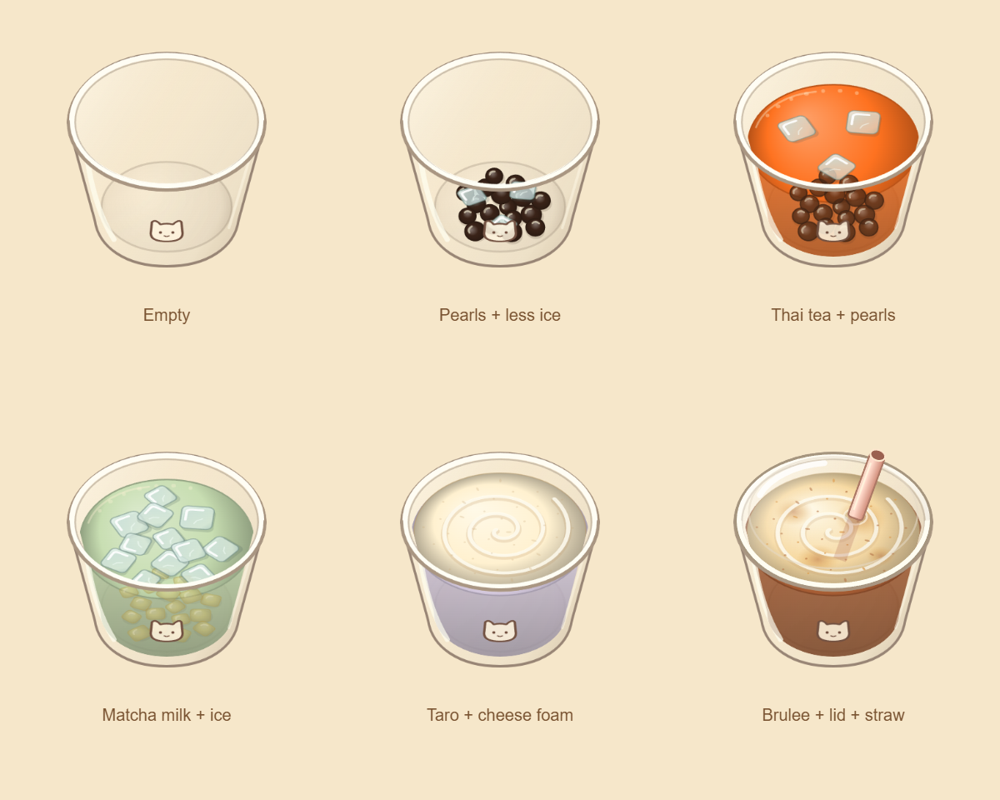

# Historical overhead cup

The active game has returned to a refined frontal cup. See [frontal-cup.md](frontal-cup.md).
The following records the previous overhead implementation and previews.

# Overhead preparation cup

The playable cup now shares the elevated viewpoint of the kitchen. Its open mouth is broad,
the body is foreshortened, and its cat print follows the short visible front face. All art is
drawn directly at device pixel density; no room image or bitmap cup asset was regenerated.
The customer's front-view cup-size illustrations retain their existing artwork.

## Projection and layers

`src/art/cupGeometry.ts` owns the 113 x 125 box, 48 x 33 mouth centered at (56.5, 42), and
base contact y92. The surface rises continuously from y86/rx34 to y42/rx48 as fill reaches 1.
Liquid, ice, foam, and pour endpoints share this geometry. S/M/L keep their existing width
scales. Mat placement, rack dragging, lidding bay, press head, tool landing, and shadows use
the new dimensions and anchors.

`src/kitchen/cupPainter.ts` paints one canvas: transparent rear glass, inset floor, tea surface
and front body, scattered floor toppings, floating ice, foam, then the front glass and rim.
Milk softens the submerged toppings. All nine toppings have shaded overhead footprints:
round pearls, elongated beans, or softly rounded jelly/pudding cuts. Ice shows rounded top
faces with melted edges, small highlights, faint tea tint, and short contact shadows.

`createIceLayout(cupId)` stores normalized disk positions. One scoop remains three large
cubes; a second fills the gaps to twelve without moving the first. New cups vary, while
reloads and later pours preserve the arrangement. Every complete footprint fits its plane
before clipping. Portions retain their positions when another topping is added.

`creamPainter.ts` draws an ivory cheese cap or golden brulee cap, with a shallow projected
spiral, bubbles, and caramel patches/flecks for brulee. Cream follows the surface and stays
behind the near rim. `finishingArt.ts` draws the overhead clear lid and short projected straw.
The carried straw retains its separate equipment illustration.

The old cup/glass/cream and twenty-four tea crop textures are no longer imported or loaded
by the game. Their source files remain as design history.

## Verification

- `npm run build` and `npm test`.
- Geometry regression checks cover 40 cup seeds, 4,320 complete ice footprints across
  empty/partial/full/overflow fills, continuous rise, and shared pour endpoints.
- Browser checks cover S/M/L rack pickup, ingredient additions, live pours, dragging,
  lidding, straw placement, resizing, device-density textures, and no runtime errors.
- Desktop and phone previews: [desktop](cup-overhead-desktop.png), [phone](cup-overhead-phone.png).
